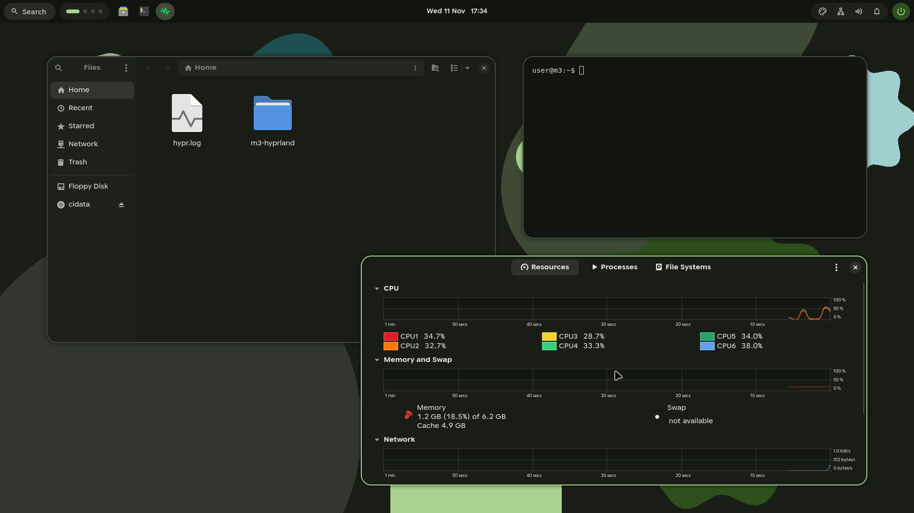
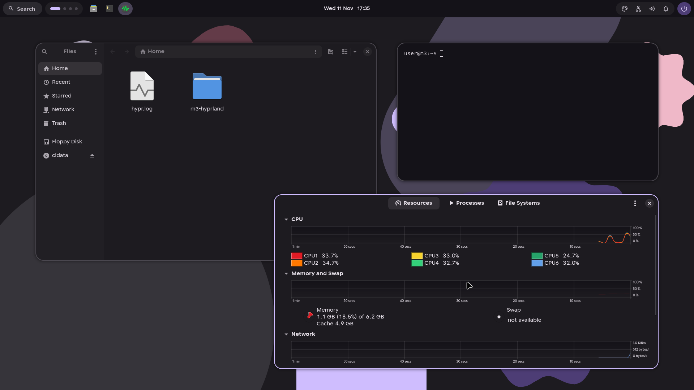
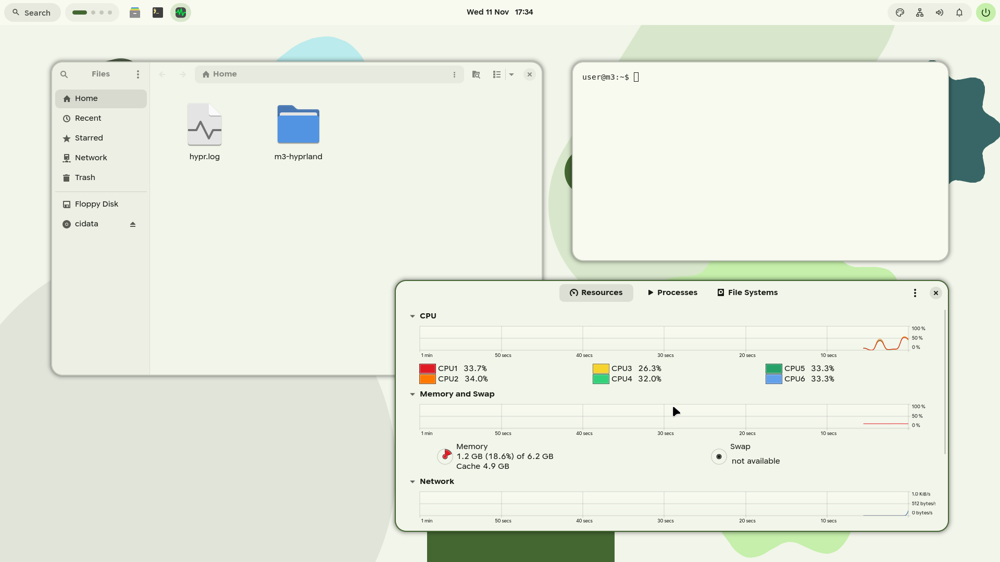
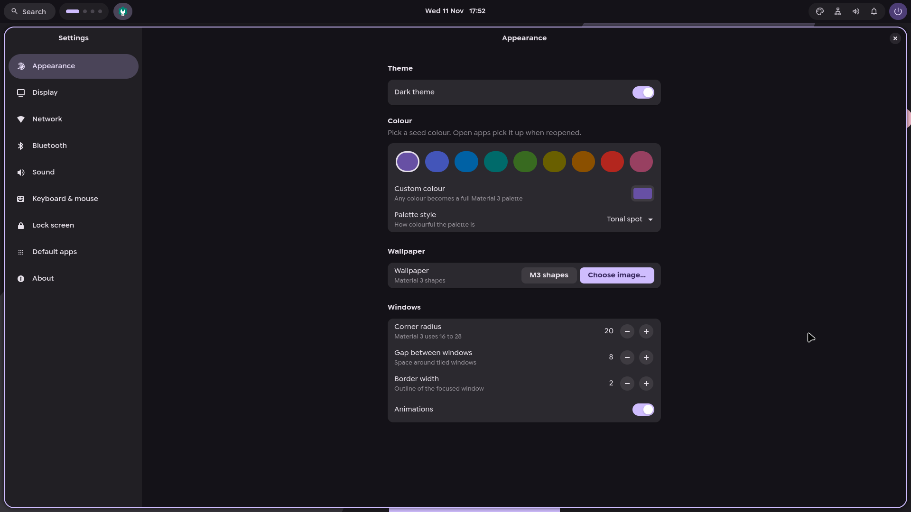
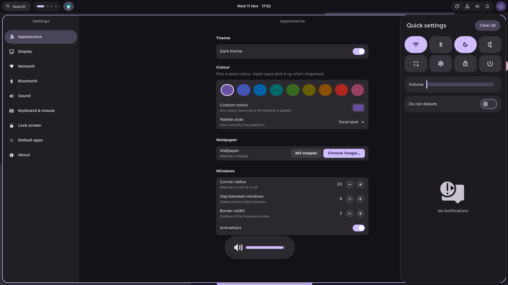

# Material 3 Hyprland

A complete, cohesive **Material 3 (Material You)** desktop environment built on top of [Hyprland](https://hyprland.org/), with dynamic color extraction, visual settings, intuitive multi-monitor management, and familiar desktop keyboard shortcuts.



---

## Highlights

- **Dynamic Material You Theming**: Full-desktop palette generation powered by [Matugen](https://github.com/InioX/matugen). Pick a seed color or extract tones directly from any wallpaper. Changes apply live across Hyprland, GTK 3/4, Waybar, SwayNC, Foot, Fuzzel, and SwayOSD.
- **Visual Display Arrangement**: Built-in multi-monitor drag-and-drop management in Settings (`Super+I` > Display). Drag screens to match physical placement on your desk with edge snapping, resolution selection, high refresh rates (up to 165Hz+), and scaling.
- **Customizable Top Bar**:
  - 12-hour AM/PM or 24-hour clock with toggleable date and seconds
  - Custom launcher icons (Search, Apps grid, Sparkle, Linux Tux, Terminal, Star) and label toggles
  - Material 3 workspace indicators and dynamic window taskbar
  - Status pills for audio, network, battery, notifications, and power
- **Credential & Key Management**: Integrated GNOME Keyring daemon (`secrets`, `pkcs11`, `ssh`) and Seahorse GUI ("Passwords & Keys") in Settings for managing passwords, SSH keys, and Git credentials.
- **Familiar Controls**: Windows-style shortcuts (`Super+I` for Settings, `Super+E` for Nautilus, `Super+L` for Lock, `Ctrl+Alt+Del` for Power menu, `Alt+Enter` for app search).
- **Night Light**: Blue light reduction via `hyprsunset` with configurable color temperatures.

---

## Gallery

| Dark Mode | Light Mode |
|---|---|
|  |  |

| Display & Settings | Quick Settings & Notifications |
|---|---|
|  |  |

---

## Requirements

Supported distributions:
- **Pop!_OS 24.04+ / Ubuntu 24.04+** (using `ppa:cppiber/hyprland`)
- **Debian 13 (Trixie)** (using `trixie-backports`)

Core components:
- `hyprland` (0.57+ with Lua configuration)
- `waybar`, `swaync`, `swayosd`, `fuzzel`, `foot`, `hyprlock`, `hypridle`
- `gnome-keyring`, `seahorse`, `libsecret-tools`
- `python3`, `python3-gi`, `gir1.2-gtk-4.0`, `gir1.2-adw-1`

---

## Installation

Clone this repository and run the installer as your regular user:

```bash
git clone https://github.com/Ezmanw/m3-hyprland.git ~/Documents/m3-hyprland
cd ~/Documents/m3-hyprland
./install.sh
```

### Options

```bash
# Skip installing the Flatpak emoji picker:
./install.sh --no-emote

# Also install the Material 3 SDDM login theme:
./install.sh --login-screen

# Revert to your previous display manager:
./install.sh --remove-login-screen
```

> **Note**: Any existing configuration files in `~/.config` are safely backed up to `~/.config/m3-hyprland-backup-<timestamp>`.

---

## Configuration & Settings

Launch Settings anytime with **`Super+I`** or from the app launcher:

- **Appearance**: Switch between light and dark modes, choose seed colors or custom hex palettes, set wallpapers, and configure window corners and gaps.
- **Display**: Visually drag and position multiple monitors, select resolutions and refresh rates, adjust display scaling, and configure Night Light.
- **Top bar**: Switch between 12-hour and 24-hour clock formats, show/hide dates and seconds, customize launcher icons, and toggle modules.
- **Lock screen & Security**: Set idle sleep/lock timeouts and manage saved passwords and SSH keys via Passwords & Keys (Seahorse).
- **User Tweaks**: Put your custom Hyprland overrides in `~/.config/hypr/user.lua` — the settings app and installer will never overwrite it.

---

## Keybindings Cheat Sheet

| Shortcut | Action |
|---|---|
| `Super + I` | Open Settings |
| `Alt + Enter` or `Super` | Open App Launcher (Fuzzel) |
| `Super + Return` | Open Terminal (Foot) |
| `Super + E` | Open File Manager (Nautilus) |
| `Super + L` | Lock screen |
| `Ctrl + Alt + Del` | Power & Session Menu |
| `Print` | Screenshot selection to clipboard |
| `Super + V` | Clipboard history |
| `Super + Q` | Close active window |
| `Super + 1-4` | Switch to workspace 1-4 |
| `Super + Shift + 1-4` | Move active window to workspace 1-4 |

---

## License

MIT License. See individual tool licenses for upstream components.
